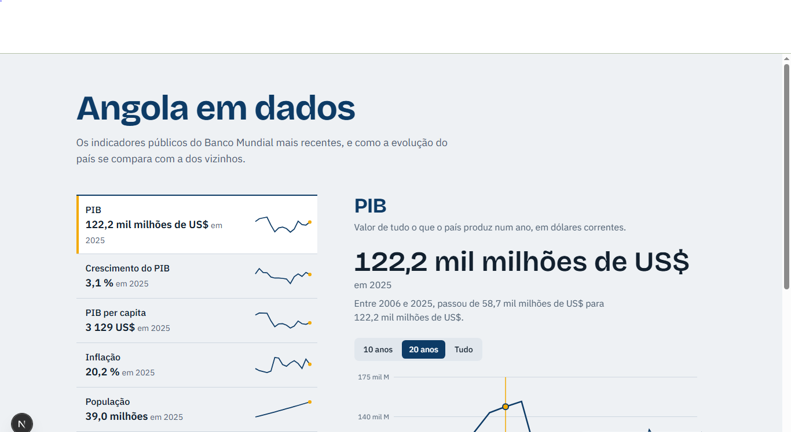

# Angola em dados

Painel interativo com a evolução de Angola em indicadores públicos do Banco Mundial: economia, população, emprego e acesso a serviços. Mostra cada indicador ao longo dos anos e compara Angola com países vizinhos.

**Demo:** _(https://angola-em-dados.vercel.app/)_

[](https://github.com/Ismaelnexdev/angola-em-dados/actions/workflows/ci.yml)
[](LICENSE)



## O que faz

- **Índice de indicadores:** os 9 indicadores de uma só vez, cada um com o último valor, o ano a que pertence e uma mini-linha da evolução recente.
- **Gráfico por indicador:** últimos 10 anos, 20 anos, ou todo o histórico desde 1990.
- **Comparação entre países:** junta até 3 países (de 6 vizinhos) a Angola no gráfico, com um traço diferente para cada um.
- **Como Angola se compara:** barras com o último valor de cada país e a posição de Angola entre eles.
- **Acessível:** navegação por teclado, controlos nativos, leitura correta em leitores de ecrã, e animações desligadas para quem as desativou no sistema.

## Indicadores

| Indicador | Código do Banco Mundial |
|---|---|
| PIB | `NY.GDP.MKTP.CD` |
| Crescimento do PIB | `NY.GDP.MKTP.KD.ZG` |
| PIB per capita | `NY.GDP.PCAP.CD` |
| Inflação | `FP.CPI.TOTL.ZG` |
| População | `SP.POP.TOTL` |
| Esperança de vida | `SP.DYN.LE00.IN` |
| Desemprego | `SL.UEM.TOTL.ZS` |
| Acesso à eletricidade | `EG.ELC.ACCS.ZS` |
| Utilizadores de internet | `IT.NET.USER.ZS` |

Países de comparação: Nigéria, África do Sul, Moçambique, Namíbia, Zâmbia e RD Congo.

## Fonte dos dados

[API aberta do Banco Mundial](https://api.worldbank.org/v2), que não precisa de chave. Os dados têm atraso: o ano mais recente costuma vir vazio, e cada indicador pode ter o último valor num ano diferente. Por isso o painel mostra **sempre o ano ao lado do valor**.

## Decisões técnicas

- **Dados pedidos no servidor, com cache.** Os pedidos à API têm cache de 24 horas e a página é regenerada de hora a hora. Na prática a API é consultada uma vez por dia por indicador, e uma falha corrige-se na hora seguinte, em vez de ficar gravada.
- **Cliente de dados robusto** (`src/lib/worldbank`): valida os códigos antes de montar o endereço, tem limite de tempo, tenta de novo até 3 vezes em falhas de rede ou erros do servidor, e lança erros claros. Testado com respostas simuladas, incluindo anos sem dados, pedidos inválidos e API em baixo.
- **Falhas parciais não partem o painel.** Se o pedido com os países vizinhos falhar, tenta só Angola. Se um indicador falhar, só essa linha mostra o aviso.
- **Indicadores e países são configuração**, não código espalhado: acrescentar um indicador é acrescentar um objeto a uma lista.
- **Formatação em português com formato fixo**, igual no servidor e no navegador (evita erros de hidratação), com "mil milhões" e "biliões" à portuguesa.
- **Movimento com propósito.** O Motion (`LazyMotion`, para um pacote mais pequeno) só anima em resposta a ações: o painel entra ao escolher um indicador e as barras crescem a partir do zero. Respeita `prefers-reduced-motion`.
- **Não depender só da cor.** Cada país no gráfico tem um traço diferente (tracejado, pontilhado, traço-ponto), por isso distinguem-se mesmo sem ver cores.
- **Controlos nativos** (botões de opção e caixas de seleção) com estilo próprio, o que dá acessibilidade e teclado sem código extra.

## Limitações conhecidas

- Só usa o Banco Mundial. Os valores mais recentes podem ser estimativas e ser revistos mais tarde.
- Só 6 países de comparação, e no máximo 3 em simultâneo no gráfico.
- Só tem tema claro.
- Não exporta os dados.

## Tecnologias

Next.js, React, TypeScript, Tailwind CSS, Recharts, Motion, Vitest e GitHub Actions.

## Executar localmente

Requer Node.js 22 (LTS) ou superior.

```bash
git clone https://github.com/Ismaelnexdev/angola-em-dados.git
cd angola-em-dados
npm install
npm run dev
```

Abre <http://localhost:3000>.

| Comando | O que faz |
|---|---|
| `npm run dev` | Servidor de desenvolvimento |
| `npm test` | Corre os testes uma vez |
| `npm run test:watch` | Testes que se repetem a cada alteração |
| `npm run lint` | Verifica o estilo do código |
| `npm run typecheck` | Verifica os tipos |
| `npm run check` | Lint, tipos e testes |
| `npm run build` | Build de produção |

## Estrutura

```text
src/
  app/                      Página, layout e estilos globais
  components/
    dashboard.tsx           Índice, painel de detalhe e estado da interface
    indicator-chart.tsx     Gráfico de linhas com várias séries
    sparkline.tsx           Mini-linha do índice
    latest-bars.tsx         Barras animadas da comparação
    country-picker.tsx      Seletor de países
  lib/
    format.ts               Formatação de valores em português
    compare.ts              Lógica de comparação (linhas, barras, posição)
    worldbank/
      client.ts             Pedidos à API, validação e novas tentativas
      load.ts               Carrega todos os indicadores, com plano B
      indicators.ts         Lista de indicadores (configuração)
      countries.ts          Angola e países de comparação
      series.ts, types.ts   Funções e tipos sobre séries
docs/                       Imagens da documentação
.github/workflows/          Integração contínua (CI)
```

## Próximos passos

- [ ] Tema escuro
- [ ] Mais indicadores (saúde, educação, desigualdade)
- [ ] Exportar os dados de um indicador em CSV
- [ ] Versão em inglês

## Licença

O código tem a licença [MIT](LICENSE). Os dados pertencem ao Banco Mundial e estão sujeitos aos termos de utilização dos seus dados abertos.